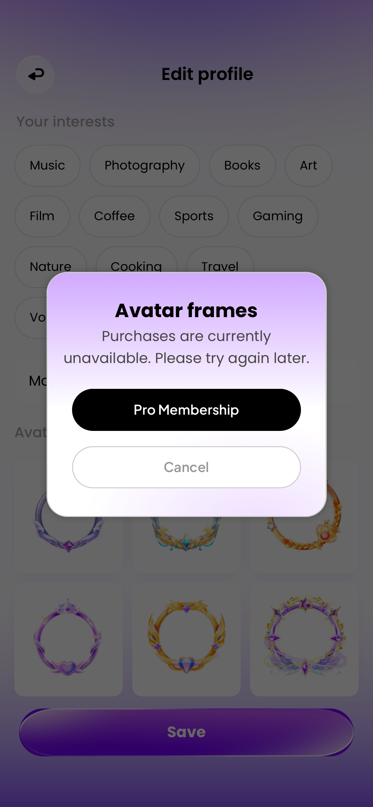

### 📢 任务修改执行报告

1. **修改了哪些文件：** `src/views/ProfileEditView.vue`、`src/components/AppModal.vue`、`src/delete-account-prompt.css`、`ios/EluvaTests/WebBundleTests.swift`；本报告与 `docs/evidence/avatar-premium-prompt-2026-10-20/`；生产 Web 资源已同步 iOS。
2. **每个文件解决了什么问题：**
   - ProfileEditView：Avatar frames 提示从普通底部弹层改为居中紫白卡片。现有说明、会员页入口及 `/store?from=/edit-profile` 返回来源不变；会员按钮移入底部操作区，新增明确的 Cancel。取消与继续忽略同一双击手势的第二次 click，继续时先关闭弹窗状态，避免重复导航。遮罩不关闭，Cancel 和 Escape 可关闭。
   - AppModal：仅增加 avatar-premium 专属面板与遮罩类；复用原焦点、inert、滚动与离开清理。未更改其他变体的逻辑。
   - 复用上一轮 `delete-account-prompt.css` 的卡片参数，通过明确的两个选择器共同使用。保持293px最大宽度、22px圆角、灰边、阴影、紫白渐变及右下柔光；标题 Poppins 700 20/30，正文 Poppins 400 15/23，按钮 Plus Jakarta Sans 600 14/18。会员按钮为黑色、取消为白色灰描边，各至少44px高。标题、正文与按钮均独立渲染。
   - WebBundleTests：新增英法原生包 WK 集成验证，覆盖一次弹窗、双击防误触、取消恢复焦点/位置/草稿、进入会员页及返回草稿；断言没有购买调用、资料保存调用或账户快照变化。另回归上一轮删号提示，确认共用样式保持一致。
3. **是否影响登录注册流程：** 否。
4. **是否影响本地用户数据：** 无数据模型、会员权益、StoreKit、资料保存或存储规则变更。头像框仍沿用原预览与未配置权益状态，本轮没有授予或购买会员，也未改变头像。原 saveProfile 函数与头像框列表逐字对照保持不变，见 `preserved-behavior.json`。所有验证使用隔离仓储。
5. **是否检查了 iOS 适配和键盘交互：**
   - 英法六尺寸各12组浏览器/WK记录：320×568、375×667、375×812、390×844、393×852、430×932；无横向溢出或按钮裁切，二级页无 TabBar。浏览器卡片高256px，英法按钮均44px，长文案自然换行。
   - WK使用实际本地包、Native Bridge 和 Scheme Handler，截图来自离屏 WKWebView。Safe Area 使用项目尺寸夹具检查，不称为真机验收。
   - 本弹窗无输入区，原资料编辑输入与键盘实现不变；本轮未验证真实系统键盘、前台模拟器触摸和真机。
6. **如何测试本次修改：**
   - `node --test tests/personal.test.js tests/commerce.test.js`：19项通过。
   - Xcode 定向5项通过：英法 Avatar 提示两项、英法删号提示两项、权威资料保存/失败/重登一项。
   - 浏览器实测双击入口只出现一份弹窗；Cancel恢复触发按钮焦点、草稿和原滚动位置；会员页返回保留未保存姓名与合理位置。日志检查未捕获 error/warn，记录见 `browser-flow.json`。
   - Vite生产构建、资源审计、iOS同步、模拟器测试构建、无签名 iPhoneOS 构建通过。dist、iOS源Web、模拟器App及设备App各255资源，哈希全部一致。未执行真实购买。
   - 复测路径：我的 → 编辑资料 → Avatar frames 任一头像框 → 检查卡片 → Cancel；再打开 → Pro Membership → 返回，确认未保存资料仍在。

设计来源：按本轮要求复用上一轮「删除账号提示」居中卡片体系；本次重新核对蓝湖 ID `41117856-99d0-47fd-afda-ce765fe4f984`，版本1，更新时间 `2026-10-13T15:14:57.206095Z`，与用户原附件一致。个人资料编辑来源 ID `7b1e83c6-51b7-4e0d-8fe8-97629eca6f5a`，更新时间 `2026-10-13T15:14:57.282313Z`。Avatar 提示是同体系适配，不声称存在一张已独立签核的同名弹窗设计。没有添加插画或新素材，没有复制删号语义。

现有购买不可用文案、会员页商品/权益状态保持原样；本轮只调整视觉与取消/导航反馈，不将未确认权益写成已经开放。上一轮记录的渐变/blur等缺失原始参数继续作为视觉补齐值，来源见 `docs/evidence/delete-account-prompt-2026-10-20/design-map.json`，未冒充新提取参数。

证据包括12张浏览器截图、英法WK基准快照、12组WK布局、测试摘要、构建日志和资源哈希。保留Vite现有大分块提示及测试结束时WebKit进程回收告警。未完成项：真机、真实系统键盘与前台触摸复核。

