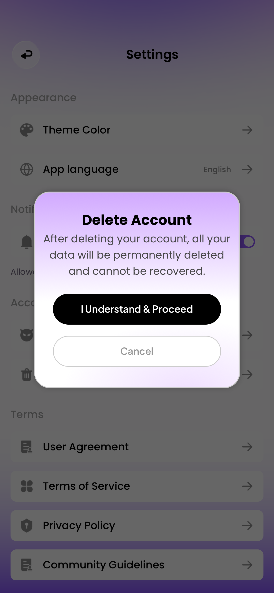

### 📢 任务修改执行报告

1. **修改了哪些文件：**
   - `src/views/SettingsView.vue`
   - `src/components/AppModal.vue`
   - `src/delete-account-prompt.css`（新增）
   - `src/data/personal-messages.js`
   - `ios/EluvaTests/WebBundleTests.swift`
   - 本报告、`docs/evidence/delete-account-prompt-2026-10-20/` 验证证据；构建产物与 iOS Web 资源已同步。
2. **每个文件解决了什么问题：**
   - SettingsView：原入口直接进入删号说明页，现在先显示蓝湖提示弹窗。取消留在设置、保留位置并恢复入口焦点；继续进入原 `/settings/delete-account` 说明及邮箱确认页。按当前路由离开时清理弹窗状态。继续操作先关闭弹窗状态，重复调用不叠加导航；忽略同一双击手势的第二次 click，避免它落在新弹窗按钮上。遮罩不触发关闭，使用 Cancel 或 Escape 关闭。
   - AppModal：只增加 `delete-account-prompt` 专属面板与遮罩类；沿用原来的 Teleport、焦点约束、背景 inert、内部滚动和关闭清理。其他变体没有改变。
   - 专属 CSS：落实紫白渐变、右下柔光、细边框、圆角和阴影；标题 Poppins 700 20/30，正文 Poppins 400 15/23、rgba(71,71,71,1)，按钮 Plus Jakarta Sans 600 14/18。两枚按钮上下排列，英文 240×44，黑色主按钮、白底灰色描边取消按钮。文字独立渲染，没有整张截图铺页面，没有假状态栏与 Home Indicator。
   - personal-messages：新增仅供入口提示使用的英法文案，英文与附件一致；原删号范围、确认页文案和服务保持原样。
   - WebBundleTests：新增英法打包 WKWebView 集成验证，覆盖入口连续点击、双击不得误触继续、取消恢复焦点、继续仅打开原确认页、不调用删除服务以及账户快照不变；记录六尺寸与基准 WK 快照。
3. **是否影响登录注册流程：** 否。没有修改认证、EULA、账户凭据或 Native Bridge。
4. **是否影响本地用户数据：** 无数据模型、持久化、删除服务或账户隔离规则变更。正式 UI 验证未执行永久删号。原邮箱确认、固定测试账号保护、最终删号弹窗、提交失败处理及幂等逻辑保留；关键原代码字节对照见 `preserved-behavior.json`。原生和 Web 删除服务回归均使用隔离临时仓储。
5. **是否检查了 iOS 适配和键盘交互：**
   - 英法各六种视口：320×568、375×667、375×812、390×844、393×852、430×932。浏览器 12 组与离屏 WKWebView 12 组布局记录通过；无横向溢出、按钮裁切或 TabBar 占位。
   - 英文 390×844 浏览器：卡片 `[48.5,273,293,279]`；标题 y298、正文 `[60,329,270,69]`；主按钮 `[75,418,240,44]`、取消 `[75,478,240,44]`，对应原稿标注。WKWebView 边框存在亚像素差异，卡片高度约279.66。
   - 法语正文自然增长至92px，主按钮换行并增长至62px；卡片约320px，不压缩字体，小屏仍完整可操作。Safe Area 以项目规则及隔离夹具注入值检查。
   - 本弹窗无输入区，不新增键盘处理；后续确认页输入代码未修改。未进行本轮真实系统键盘、前台模拟器触摸或真机验证；WK快照来自离屏测试，不冒充真机截图。
6. **如何测试本次修改：**
   - `node --test tests/personal.test.js`：13项通过，包含删除失败回滚、幂等、目标账户隔离及固定账号保护。
   - 最终定向 Xcode 测试4项通过：英法入口弹窗 WKWebView 两项、原生删除账户隔离/失败回滚和固定账户保护两项。最终结果见 `native-test-summary-final.json`、`wkwebview-final.log`、`native-final/`。
   - Vite 生产构建、资源审计、iOS同步、模拟器测试构建和无签名 iPhoneOS 构建通过。dist、iOS源 Web、模拟器 App、设备 App 各255个资源，逐文件哈希相同。
   - 浏览器首轮实际验证取消保留滚动并恢复焦点。发现双击误触继续后已修复，并在最终 WK 测试中验证。此后浏览器 AX 抓取不稳定，未将最终浏览器双击复测写为已通过；记录保留于 `browser-flow.json`。布局截图是在最终同一版 CSS 下保存，后续只改了点击防误触。
   - 开发者复测：登录 → 我的 → 设置 → 删除账号；检查卡片 → Cancel 回设置；再打开 → I Understand & Proceed 进入原邮箱确认页；返回设置。使用普通注册账号核对后续确认，固定测试账号继续禁止删除。无需为本轮样式复测执行永久删除。

设计依据：蓝湖「删除账号提示」，ID `41117856-99d0-47fd-afda-ce765fe4f984`，版本1，更新时间 `2026-10-13T15:14:57.206095Z`。已重新读取设计原图、版本和图层标注；附件780×1688对应390×844的2倍图，接口195×422为半尺寸预览。`design-map.json` 保存本次取值来源；`design-reference.png` 保存用户原稿。

参数缺口与差异：蓝湖本次回退标注模式，未返回卡片渐变完整色标、柔光 blur、边框与圆角、遮罩透明度，也未提供独立卡片背景切图。上述缺项按附件对照采用专属 CSS 补齐：22px圆角、1.5px灰边、60%黑遮罩、顶部紫白渐变与右下径向柔光；这些是视觉补齐值，不宣称为完整导出的原始参数。原设计可读取的字体、字号、字重、文字色与黑色按钮等按标注落实。卡片范围以外保留现有设置项，因此背景中仍有已确认的主题和语言设置入口。

未完成项：真机及前台 WKWebView 触摸复核、真实系统键盘复核仍待执行；缺失的原始渐变/blur参数有待设计端补全。保留 Vite 原有大分块提示和测试结束时的 WebKit 进程回收告警，不声称构建控制台零警告。

