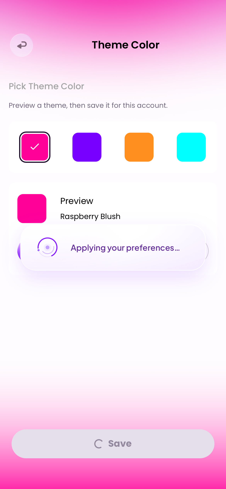
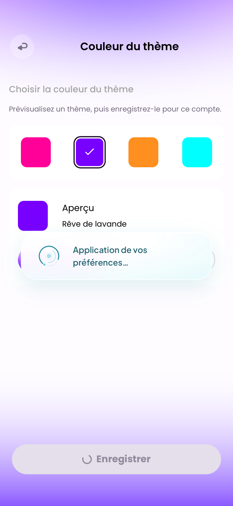

### 📢 任务修改执行报告

1. **修改了哪些文件：**
   - `src/components/AppLoadingToast.vue`：全局浮层显示、结果优先及路由／账户／后台监听。
   - `src/components/EchoLoadingIndicator.vue`、`src/echo-loading.css`：回音双环、光点、呼吸中心与居中玻璃卡片；英法、四主题、Safe Area、可视视口及减少动态适配。
   - `src/services/loading-toast.js`：实际提交操作白名单与可清理的呈现状态机。
   - `src/data/loading-messages.js`、`src/i18n.js`：独立英法操作文案。
   - `src/App.vue`：在原结果toast旁挂载唯一loading浮层。
   - `tests/loading-toast.test.js`、`ios/EluvaTests/WebBundleTests.swift`：生命周期单测及隔离WKWebView验证。
   - `docs/app-flow-and-implementation-plan.md`、本报告与`docs/evidence/loading-toast-2026-10-23/`：本轮范围和证据；`ios/Eluva/Web/`同步生产资源。
2. **每个文件解决了什么问题：**
   - 用户已明确只改“浮层式loading提示”。现有代码原本只有结果toast，没有独立loading浮层；本次增加唯一的提交浮层，没有将所有`ui.busy`一律覆盖，也不改按钮转圈、页面Loading文字、骨架、首页发现／Light Up或下拉刷新控件。
   - 视觉取自已确认的Chats下拉刷新：细双环、环绕卫星光点、柔和呼吸中心，沿用紫／粉／橙／青四套颜色；玻璃卡片居中，柔和描边和阴影，文字独立渲染。环转1.6s、中心呼吸2.4s，只有小幅透明度变化，不闪烁、不使用标题图标、emoji、百分比或虚假进度。这是用户授权的风格延伸，不冒称蓝湖新增参数。
   - 仅发布、资料／合集保存、偏好保存、举报／反馈及已有删除提交使用浮层。读取、聊天发送、关注、登录注册、录音／通话、媒体选择和StoreKit系统付款保持原反馈，避免覆盖原生权限或付款界面。
   - 220ms仅是出现延迟，防止快请求闪现；不延迟真实请求、成功结果或导航，不设置最短停留。真实busy结束立即移除，错误／结果提示优先；后台暂停呈现，离页／换账户永久作废旧显示任务。计时器使用代次和操作身份校验，同名重试不会复活旧反馈。
   - body Teleport、`pointer-events:none`，不加遮罩、inert、焦点转移或新业务锁。沿用原操作的disabled／critical保护，不虚构“取消”能力。纯状态区域保留`role=status`、polite与atomic，避免在状态文字自身设置永不结束的aria-busy；按钮的原busy语义保持。
3. **是否影响登录注册流程：** 否。认证操作不在白名单，不修改账户创建、登录、验证码、引导或启动握手。
4. **是否影响本地用户数据：** 否。浮层只读取现有操作状态；不新增持久化字段，不修改服务、原生Bridge、数据模型或关系权限。测试使用独立仓库、偏好及非持久WK数据，不清空已有账户；本轮临时QA模拟器已移除。
5. **是否检查了 iOS 适配和键盘交互：** 使用现有visualViewport变量与Safe Area，不增加假的状态栏或Home Indicator。具体WK矩阵及键盘验证结果见下方；真机和VoiceOver仍待实际设备复核。
6. **如何测试本次修改：**
   - 180项Web自动化通过，含本轮7项生命周期测试：快速完成不显示、慢操作显示一次／结束立即隐藏、结果／错误／后台优先、旧回调不能复活或清除新计时器、路由／账户失效、同名重试、未知操作／原型属性排除、卸载清理、默认浏览器计时器调用与完整英法文案。
   - Vite生产构建、265资源审计和iOS资源同步通过。
   - 无签名设备Release构建通过。

   - 最终两项英法可见WKWebView测试通过：六尺寸紫色共12组，390×844粉／橙／青共6组，共18组；检查实际已应用主题及计算颜色，不把待保存预览当成已切换主题。实际保存、慢请求挂起、重复点击仅一次请求、原按钮spinner保留、原critical返回锁保留、无新增遮罩／inert／焦点转移均通过。
   - 慢请求实际出现延迟为221–240ms；失败后立即隐藏、选项保留，重试保存成功后进入设置并清除浮层。后台隐藏、前台仍在请求时重新出现，减少动态停转，随后经正常退出登录到欢迎页不残留。
   - 快请求场景如实记录：法语实际15ms、浮层出现0次；英语本次为259ms、超过220ms出现阈值，因此出现1次，不将该次称为“快速无闪现通过”。快请求不显示的通用规则另由单测覆盖，不为测试人为延长真实业务。
   - 八张390×844实际WK截图已导出，已查看英文紫色和法语青色图；18组均无横向溢出或提示卡裁切，法语可完整换行。一个隔离iPhone17／iOS26.5模拟器内调整WK尺寸与安全区，不是六种真机。
   - 键盘验证仅模拟`visual-height=360px`、`visual-top=48px`的可视区域几何，未弹出系统键盘；后台显隐及减少动态也使用明确标注的visibility／MediaQueryList夹具。真机键盘、性能及VoiceOver仍待实际设备复核。
   - 265项运行资源在dist、iOS源资源、模拟器Debug包及无签名设备Release包逐项SHA-256一致。同步流程额外的`.generated-files.json`是预期索引，内容的265项条目也已核对，未计为运行素材或残留资源。
   - 首轮两项WK测试在慢请求等待处失败，诊断保留。真实请求已挂起且busy=true，但HUD不存在；默认浏览器计时器作为类实例方法调用存在receiver兼容风险。修为箭头包装、补计时器调用单测后，同一WK场景通过。首轮未捕获到字面的Illegal invocation错误，不伪称该报错已被日志证实；最终生产资源及测试均包含修正。
   - 既有Vite大分块提示、测试`UIApplication.windows`弃用提示及模拟器WebKit进程回收诊断保留，未扩展到无关代码调整。
   - 复测：资料／合集保存或发布等真实提交耗时超过220ms时出现居中浮层；连续点击不新增提交；完成后消失；故障后原输入与重试入口保留。主题按保存成功才应用；快速本地提交可能直接完成，这是预期行为。StoreKit系统付款、认证、页面骨架与下拉刷新沿用原样。

[验证汇总](./evidence/loading-toast-2026-10-23/verification-summary.json) · [截图索引](./evidence/loading-toast-2026-10-23/wk-attachments.json) · [资源一致性](./evidence/loading-toast-2026-10-23/resource-consistency.json)

