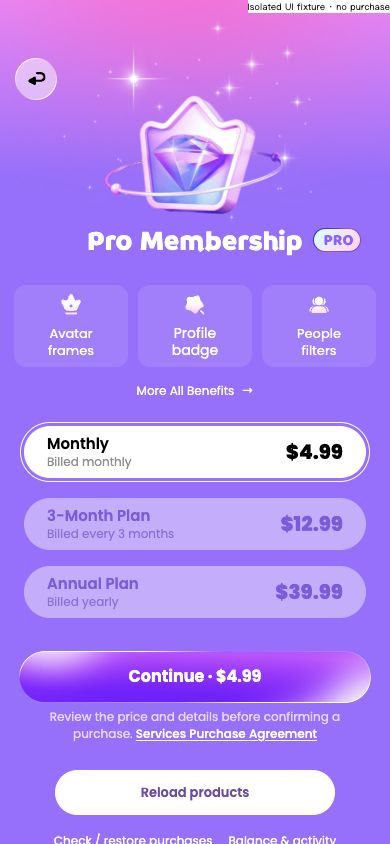
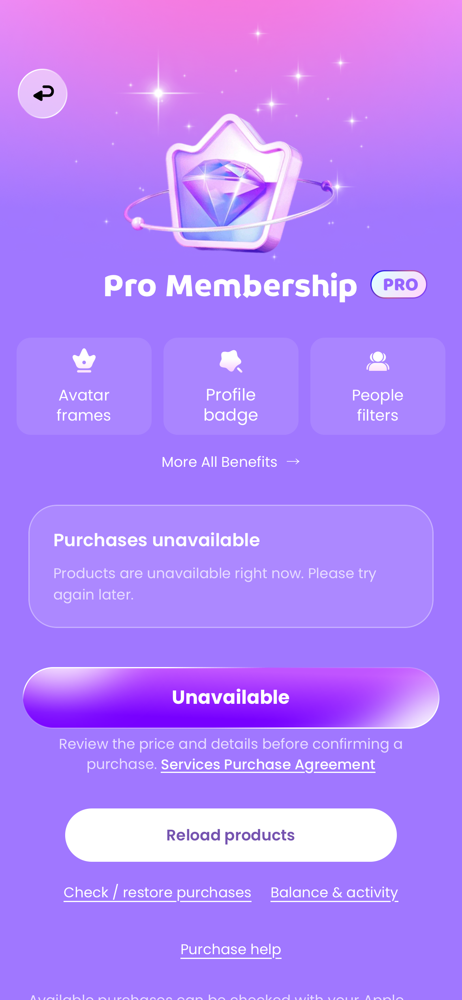

### 📢 任务修改执行报告

1. **修改了哪些文件：**
   - `src/views/StoreView.vue`
   - `src/membership.css`（新增）
   - `public/images/p6/membership-scene.png`、`membership-back.svg`（新增）
   - `tests/fixtures/membership.html`（新增，开发隔离夹具）
   - `ios/EluvaTests/WebBundleTests.swift`
   - 本报告与 `docs/evidence/membership-ui-2026-10-20/`；生产资源已同步 iOS。
2. **每个文件解决了什么问题：**
   - StoreView：仅会员主页面启用 membership-shell，权益表与余额页面继续使用原布局。保留 ContentShell 的真实返回按钮与主滚动容器，隐藏重复的可见导航标题，主标题独立渲染。协议入口移到购买按钮下方，保留原协议弹层；其他重载、恢复、余额和帮助操作继续存在。加载未结束时不显示“商品不可用”的说明，失败通过原错误码展示并保留重试。
   - membership.css：落实粉紫场景、钻石与星光层级、Braah One 28/400/39 标题、PRO 原始徽标、三张半透明权益卡、6.05px背景模糊、套餐选中描边与颜色、Poppins 字体、主按钮原始渐变、购买说明及链接。仅会员主页面受影响，不缩小整页或压缩字体。
   - 场景资源：从本次重新下载的蓝湖原始4倍PNG中无缩放裁切出1556×900装饰区域（逻辑389×225）。它只含背景、星光与钻石；原图标题墨迹从y230开始，原PRO徽标也未进入裁切范围。原 SVG 的光晕离线渲染存在偏色，最终使用原PNG像素。文字、权益、商品、价格和按钮均由组件独立绘制。返回按钮复用项目既有 Group 8 原始SVG，修正旧不透明PNG底座；仅 /store 使用半透明底座，触摸区域44px。
   - 继续复用本地原始 crown/spark/people 图标、PRO徽标、购买胶囊SVG、Braah One与Poppins。无emoji替代、远程运行资源或整页截图背景。
   - 开发夹具：随机独立数据库；三档套餐名称和价格仅用于视觉对照，页面明确显示隔离夹具标记；购买请求始终失败且不发权益。夹具与价格未进入生产构建。
   - WK测试：新增英法未配置页面、实际StoreKit商品读取检查；验证尺寸、协议、权益表、余额返回，以及会员样式不影响子页面。后两项读取检查因本轮 StoreKitTest 系统错误跳过，没有伪造返回成功。
3. **是否影响登录注册流程：** 否。认证、协议同意、账户凭据、Native Bridge均未修改。
4. **是否影响本地用户数据：** 无模型、存储、商品配置、权益、额度、购买或恢复规则变更。StoreView脚本除样式导入外逐字不变；所有服务调用与参数仍使用原链路。正式 commerce-policy 仍 confirmed=false、products=[]。没有实际购买、发放权益或删除账户数据；验证使用隔离仓储。
5. **是否检查了 iOS 适配和键盘交互：**
   - 英法各六尺寸：320×568、375×667、375×812、390×844、393×852、430×932。
   - 浏览器24组记录：三套餐视觉夹具与当前商品不可用状态各12组；主滚动区无横向溢出，文字与按钮保持原字号，小屏内容自然滚动，二级页无TabBar。
   - 390×844英文基准：主标题y222；权益卡 `[14,285,362,82]`；套餐区 `[24,426,342,192]`，单条52px高；购买按钮 `[19,651,352,52]`，包含原素材边缘，其内部原稿按钮对应350×50。已修正图层、顶部粉色光晕、返回底座和套餐基线差异。
   - 图像装饰与相应留白随视口宽度变化，文字和控件独立布局；不是整页等比缩放。法语商品描述和完整价格允许自然换行，320法语夹具使主按钮下移17px，未裁切或缩字体。
   - 离屏WKWebView记录12组当前未配置状态及英法基准快照，实际通过本地Scheme Handler与Native Bridge。未进行前台模拟器触摸、真机或真实系统键盘验证；本页没有输入框，没有新增键盘处理。
6. **如何测试本次修改：**
   - `node --test tests/commerce.test.js tests/personal.test.js`：19项通过。
   - 最终打包定向原生6项通过：英法会员页面两项、英法Avatar提示/会员返回草稿两项、交易去重/保存失败恢复和未配置禁止发放两项。协议弹层、权益表和余额往返、只读展示与无购买调用均已检查。
   - StoreKit读取另行尝试：系统日志报告 SKInternalErrorDomain Code=3，测试目录返回空；英法两项实际商品读取检查明确跳过。见 `storekit-attempt-summary.json` 和 `wkwebview-final.log`。本轮没有把夹具价格描述为已通过的真实StoreKit结果。
   - 浏览器实测：套餐选择更新选中态及原CTA；换语言、进入权益表/余额再返回仍保留选择；协议可打开关闭；商品读取失败显示STORE_FAILED，重载恢复；真实读取被夹具持有时显示Working与禁用状态，释放后恢复，不使用固定等待。未点击购买。相关记录为 `browser-flow.json`、`browser-recovery.json`。
   - Vite生产构建、资源审计、iOS同步、模拟器测试构建和无签名iPhoneOS构建通过。四份资源（dist、iOS源Web、模拟器App、设备App）各257个，哈希完全一致；生产包不存在夹具套餐ID、$4.99/$12.99/$39.99或夹具标签。
   - 开发者复测：我的 → 会员，或编辑资料 → Avatar frames → Pro Membership；检查返回、更多权益、协议、恢复/帮助入口。正式商品未配置时应显示不可购买，可重载和查看恢复说明；不得出现设计里的固定示例价格。

设计依据：蓝湖「充值」ID `7574cbf3-7a5f-467f-a7af-6c582c36ee4a`，版本1，更新于 `2026-10-13T15:14:57.20977Z`；与用户附件「充值.png」核对。附件780×1688对应390×844的2倍图；接口195×422与切图389×841分别记录，不混作CSS尺寸。原稿、重新读取的图层参数、资源来源及差异保存在 `design-reference.png`、`design-map.json`、`background-original.svg` 和 `background-source.png`。

保留的业务差异：原稿两个权益卡重复写avatar frames，本轮保留既有Avatar frames / Profile badge / People filters语义；原产品名称、描述、计费周期、完整本地化价格和Continue按钮数据均继续来自现有状态。货币符号不拆解，完整displayPrice使用20px字重800展示，独立ISO代码保留供辅助阅读。原稿同时出现按月与一次支付不续费的矛盾描述未复制。正式套餐、商品类型、权益、示例价格不因本轮视觉工作变为已确认要求。重载、恢复、余额与帮助入口保留，因此页面比原静态稿更长。

未完成项：StoreKitTest恢复后的真实商品读取与商品态WK截图、Apple沙盒及真机验证。既有商业配置确认不在本轮UI范围内。保留Vite大分块提示及测试结束时WebKit进程回收告警，不声称控制台零警告。

