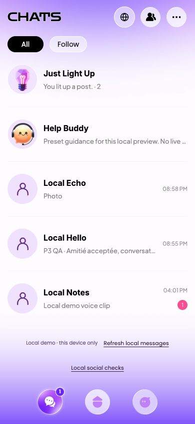

# P3 资料、关系与消息实施报告

日期：2026-10-17（Asia/Shanghai）。范围：P3，以及资料公开读取、好友可见帖子、既有媒体桥接和安全状态同步等直接依赖。

P3 本地闭环已实现：单向关注与一次好友申请分离，接收方接受后解锁会话，拉黑立即阻断；固定测试账号保留至少两组好友和文字／语音会话。Web 与原生仓储测试、浏览器流程、双语六尺寸矩阵、生产构建和资源同步通过。正式视觉签核、P3 原生界面与真机验收仍有待办，不能视为发布验收完成。

## 1 修改文件与目的

逐文件目的、SHA256 和生成文件说明见 [source-files.json](evidence/p3/source-files.json)。仓库在本阶段开始时全部文件已处于 untracked 状态，本清单是明确的阶段修改记录，不能冒充相对历史提交的 Git diff。

- `src/domain/social.js`、`src/services/browser-social.js`、`src/social-state.js`：增加关系、申请、好友、线程、消息、已读和本地帮助，复用原 IndexedDB 事务、统一 Bridge 和响应式快照；补齐账户隔离、失败回滚、稳定提交和媒体授权。
- `ChatsView.vue`、`FriendsView.vue`、`ProfileView.vue`、`ConversationView.vue`、`HelpView.vue`：实现真实页面／状态／返回，消息、资料、好友和公开动态即时同步。图库与介绍／举报／拉黑／已读确认均有可取消路径。
- `PersonAvatar.vue`、`ConnectionAction.vue`、`SocialSafety.vue`、`social.css`、双语文案与本地素材：延续蓝湖有效视觉，替换旧关注解锁聊天、假在线和假客服含义。
- 原页面壳、弹层、TabBar、路由和 P2 内容服务：显式透传壳的样式，支持测量锚点菜单和居中确认，真实未读徽标、作者资料跳转、共享好友／拉黑权限及安全媒体读取。保持原 P1 弹层默认行为。
- `ios/Eluva/SocialRepository.swift`、原 `LocalRepository.swift`／`ContentRepository.swift`：通过同一原生仓储队列、加密 vault 和媒体目录实现对应事务；复用现有 `NativeBridge.swift` 与 `MediaCoordinator.swift`，这两个文件本轮未改，也未建立第二套协议。
- 测试、资源准备／审计／同步脚本、生成 Xcode 工程、README 与计划：覆盖新源码和实际本地资源，保留各阶段历史证据。

未修改 `AGENTS.md`、`AGENTS_UI.md`，未接入真实后端、云数据库、邮件、审核客服、支付或在线聊天服务。

## 2 设计依据、倍率与缺口

实施前重新读取蓝湖条目、当前版本、原图、图层标注与切图。完整 ID／更新时间见 [design-sources.json](evidence/p3/design-sources.json)，[逐页契约](p3-route-contracts.json)把每个正式页面／弹层与来源、入口、操作、返回、全部状态、校验、保存及原生依赖对应起来。

核心来源均为 **版本1**，更新时间保留 UTC 原值：

- 消息 #82 `a8a527a2-8862-4c27-a433-35f27599044a`，`2026-10-13T15:14:57.306156Z`；关注分类 #47 `2950fb24-01e5-4f15-97c0-a2156c5f0eeb`；仅点亮 #103 `1b615b7d-76c4-44c0-b769-2888905d8198`。
- 他人资料未关注 #56 `02fd48f0-1c13-4a41-a54f-418bcfcb437a`，`.393867Z`；已关注 #19 `329febca-a76a-49b9-b797-8c1ba259d194`，`.240436Z`。
- 好友列表 #81 `14b1cb80-2a70-461a-b212-41dec03eca70`，`.308053Z`；好友申请 #21 `4664da33-02c9-44f7-856a-0db0bc85c864`，`.227710Z`。
- 会话参考 #87 `3d265403-9ba8-419f-a3a0-ec6d059bbc43`；表情 #12 `a0f8f326-7217-4866-bac0-5687e2f76588` 与 #40 `0d51dac3-c258-4c71-9ac3-e6e4fd321ecc`。
- 帮助 #13 `9fc8fcda-06c1-48ac-9e46-6a23b9d5e37d`；点亮已读确认 #16 `39d224fc-857d-4dd0-a8e4-9bb0eff9c0c0`；更多 #31／83；旧非关注不能聊天 #99；举报／拉黑沿用 #17／41。

图层逻辑基准为 **390×844**，清单的195×422是缩略预览，本地PNG按2x导出。原始15张参考图保存于 [references/index.json](evidence/p3/references/index.json)，图层文字／CSS／颜色／阴影等保存在 `spec-01.json` 至 `spec-15.json`。未把整张设计图缩放为应用页面，核心控件使用流式布局。

### 参数和素材落实

- Chats：Zen Dots24/400/29、白描边；姓名Inter16/700/19；摘要Jakarta13/400/16、`#8e8e8e`；时间11/400/14；徽标10/400/13、`#ff4f9a`。头像60、行节奏109、间距12、分隔线`#f6f6f6`。All／Follow使用Poppins14/400/21，32pt可见胶囊位于44pt触摸范围内。
- 好友标题Poppins18/600/27；申请姓名Jakarta15/800/19、正文15/500/21、按钮Poppins14/600/21、白色圆角12卡片和原稿紫色Profile描边。
- 资料姓名Jakarta24/800/30、简介14/500/21、关注14/600/18、统计16/800/20与12/500/15；原Follow SVG的背景、遮罩、紫光与人心路径本地保留，文字独立双语显示。真实统计取关系数据，不抄设计计数。
- 消息正文Jakarta15/500/22，输入16/500/23以避免iOS聚焦自动缩放；灰／紫气泡与原稿发送图。帮助问题Inter13/500/18。28个源表情按图层x/y排序，38×38绘制、44pt触摸，短屏内部滚动；不是按导出文件顺序排布。
- 本轮新增41个PNG、2个派生SVG及Inter Medium字体。字体沿用本地Poppins、Plus Jakarta Sans、Zen Dots、Inter，并保存官方字体来源和OFL。切图源ID、图层、尺寸、字节和哈希见 [asset-sources.json](evidence/p3/asset-sources.json)。生产代码不引用蓝湖地址。
- 照片头像／资料hero采用cover，整图查看采用contain；输入、表情、弹层与核心按钮不依赖固定屏幕坐标。普通内容不可拖拽、提取或选字，输入继续支持完整编辑。

已修正的对照差异包括帮助与灯泡切图对应、表情顺序、原Follow背景、胶囊可见高度、弹层锚点、消息失败重复提示、多行说明框，以及最后原图对照发现的Chats标题被响应式规则缩小／负字距的问题。基准宽度已恢复24px自然字距，320宽采用18px；实际DOM确认法语标题与三个按钮无重叠。

### 尚未完成的视觉签核

Mac本轮一直锁屏，自动解锁失败，不能操作Chrome重新逐层点击蓝湖或验证原生界面。蓝湖连接器可以读取当前条目、标注、原图及切图；DDS schema检查返回权限失败，实际使用原始标注回退，未宣称成功生成设计代码。这与Mac锁屏是两项不同限制。

原设计人物照片／独立hero、完整毛玻璃背景与部分工具矢量未提供可独立使用的切图。人物采用本地默认头像，不生成相似照片冒充原稿；未导出的工具图标使用现有线条SVG，毛玻璃资料卡与新增异常／空态延续同一体系，差异在 [visual-audit.json](evidence/p3/visual-audit.json) 明列。

本地演示标识、语言入口、真实计数、年龄与兴趣、好友约束，以及帮助的本地边界说明属于必要业务适配。无假在线点、PRO身份、设计样本用户、假客服或远端已读。浏览器没有iOS系统状态栏／Home Indicator，演示媒体也不是原人物媒体，**尚未完成同Safe Area、同媒体、同状态的整屏像素签核**；不提供虚构还原百分比。

## 3 业务与交互结果

### 资料、关注与申请

资料从动态、会话头像、好友／申请或点亮记录进入，返回原来源；从会话往返资料再开聊天时复用原会话返回路径，避免from参数无限嵌套。公开资料不暴露邮箱和完整生日。本人资料、无照片、无公开内容、不可用和拉黑都有实际状态。

关注只修改单向follow和列表筛选，不建立好友，不解锁文字／媒体／通话。非好友最多发送一条介绍；pending不能再发第二条，发送失败保留介绍和commitId。介绍成功仅产生request，不提前建立线程。

Received／Sent使用同一实体，方向和处理权由账户决定。只有接收方可接受或忽略pending；接受在同一事务中保存申请状态、好友关系和唯一线程，失败仍保持pending。忽略先确认，取消零写入；忽略后显示终态，不自动重发。成功后资料、申请、好友、消息与Friends可见帖子同步，无需刷新。

### 会话、媒体与已读

路由页面、发送服务、导入／读取媒体和通话入口分别校验双方好友及拉黑；深链不能绕过。支持文字、Unicode表情、28个源表情贴纸，或一张真实图片加可选文字说明。选择图片、取消、删除、失败和重试均经既有媒体服务；浏览器相机不支持时明确提示，原生继续使用既有PHPicker／相机路径。

消息、文件提交标记与幂等记录同一事务保存。commitId绑定操作和payload，重复点击／相同响应重试只产生一条；更换payload复用已提交ID返回`COMMIT_CONFLICT`。失败回滚媒体提交标记，保留输入、附件与ID；成功清空当前消息草稿并生成下一个ID。图片不能作为其他账户媒体或发布合集封面复用。

会话草稿按账户＋对象保留在本次运行内存，返回、资料往返和切语言不丢；主动取消选择不产生消息。重载或退出不承诺恢复未提交正文，正式消息与已提交图片仍持久化。不增加后台上传、假延时或金币消耗。

只在接收账户实际成功打开会话时写其收到消息的readAt。发送方“已读”来自另一真实本地账户读取，仓储测试覆盖双账户；没有定时器伪造对方读取。普通已保存消息显示“Saved locally”。固定账号的语音夹具使用实际本地WAV，浏览器观察到真实播放状态、2.866秒时长；录音、通话和翻译属于P4，当前按钮通过好友检查后明确告知未接入。

### 分类、安全与本地帮助

All、Follow、仅点亮与未读筛选保存在账户偏好。点亮事件、普通消息和收到申请的未读分别计算。已读确认只提交本次列出的eventIds；取消不写入，成功也不清普通会话未读或申请。两次浏览器实走均确认普通未读保持。

举报仅保存本设备记录，明确没有发送审核团队。拉黑写入P2同一`content.blocks`，成功立即隐藏／锁定资料、列表、会话和后续媒体读取，播放停止；不能依靠旧缓存继续发送。解除只去掉本人的block，不补发消息或重发申请；保守保留既有好友实体及记录。

帮助问题胶囊只填入草稿，用户点击Save locally才保存。问题和反馈原文持久化到当前账户，说明由稳定topic匹配本地预置文案；换语言只换独立说明，不改用户内容。空态、失败和重试均有结果，不显示假客服在线或云AI答复。

## 4 已确认与技术假设

已确认并直接实现：本地模式、一次介绍、双方好友才可持续私聊、关注／点亮不等于好友、接受后解锁、拉黑优先、账户隔离、双语、失败保留、重复去重，以及至少两组好友／会话文字和语音夹具。

以下是可逆的技术预览方案，**不是用户已经确认的规则**：介绍1–500字素；消息／反馈最多2000字素；单张图片或单个贴纸可附文字；沿用P2单图20MiB与举报补充500字素。忽略后是否允许再次申请／等待期／费用，以及解除拉黑是否仍保留原好友，仍需正式产品政策。当前不开放再次申请，不发明冷却期或费用，解除时保留既有好友记录以保护数据。

本轮没有引入需要暂停实施的关键业务问题。上述假设、缺稿与未来政策均独立保留；录音／通话／翻译在P4，完整个人中心／合集管理／黑名单设置页在P5，商业权益在P6。

## 5 登录、本地数据、适配影响

认证顺序、验证码、密码规则和注册原子提交不变。共享页面壳／弹层和账户切换清理有直接依赖改动，P1与P2原测试已一起回归。固定测试账号及稳定用户ID不被新注册覆盖。

数据为增量`social.version=1`，迁移原P1的好友、线程、文字与语音ID；已有用户内容不改写。浏览器使用原IndexedDB，iOS使用原Keychain密钥＋加密vault，两个环境独立。格式损坏报`STORAGE_CORRUPT`保留原数据，不清库。媒体仅授予参与者，公开资料照片须显式打开资料／好友线程后授予当前查看者，避免放宽P1账户照片隔离。退出仅清临时草稿／授权／故障标记，不删正式数据。

固定账号初始夹具为Local Echo、Local Notes两组好友／线程，每组至少文字与真实本地语音；收到Local Hello、已发送Local Wave，另有陌生与被拉黑场景。名称和说明是Eluva自有本地样本，界面明确演示；新注册账号没有这些夹具。浏览器QA接受Hello后主预览自然有三位好友，不通过重置数据恢复截图。

已检查320×568、375×667、375×812、390×844、393×852、430×932，EN／FR；一级Chats显示TabBar，资料、好友、申请、会话、图库、帮助全部隐藏并释放占位。沿用env安全区和visualViewport.height／offsetTop；多行输入按实际可见高度增长、超长内部滚动，点击空白收焦，弹层背景inert、内容可滚动，离页取消任务并停止播放。

**P3未完成模拟器虚拟键盘、原生权限／选择器UI和真机验证**。浏览器布局／DOM焦点／窗口尺寸检查不能替代iOS键盘、系统Safe Area、真实相机和后台行为；也没有将构建日志当作运行中的Xcode界面日志。

## 6 验证结果与复测

- **Web 31/31通过**：P1／P2回归＋7项社交仓储＋实际P3视图双语键。覆盖好友迁移、单次介绍、接收方权限、接受／忽略失败重试、双账户实际已读、图片事务／归属、点亮定向已读、安全／帮助、格式损坏保留和跨P2仅好友帖子权限。[日志](evidence/p3/logs/web-tests.log)
- **原生20/20通过**：原6项P1＋7项P2＋7项P3，在专用SE iOS17.5模拟器运行仓储测试，支持实际Keychain、加密vault、文件导入与回滚。包含真实双本地账户接受／已读、跨P2好友内容、受控资料照片授权与拉黑后文件拒绝。[日志](evidence/p3/logs/native-tests.log)
- **浏览器完整实走**：关注不解锁、一次申请失败保留／重试、接受失败／重试、忽略取消／失败／终态、发送文字／源表情／实际图片、双击去重、返回／语言保留、图片失败回滚和重载、真实WAV播放、举报、本地帮助、拉黑重载与解除、新账号空态。[路径记录](evidence/p3/workflow-coverage.json)
- **40状态×2语言×6尺寸＝480张截图**，检查实际位图非空、尺寸、字体加载、页面横向溢出、弹层／底部按钮边界、TabBar层级和预期错误码。[矩阵](evidence/p3/browser-matrix.json)／[审计](evidence/p3/evidence-audit.json)。这不是自动视觉完美证明。截图跨已记录迭代采集；有影响的状态已重拍，原applicationScript与时间可在[构建迭代记录](evidence/p3/build-iterations.json)追溯，不宣称所有截图来自同一二进制。
- **生产构建、同步与iOS两类编译通过**：98个本地资源在dist、iOS/Web、模拟器app/Web、未签名设备app/Web四份SHA256一致，没有旧hash残留。清理只作用生成Web文件，不接触Application Support或账户数据。[资源清单](evidence/p3/build-manifest.json)／[Web日志](evidence/p3/logs/web-build.log)／[模拟器编译](evidence/p3/logs/simulator-build.log)／[设备编译](evidence/p3/logs/unsigned-device-build.log)。仅有Apple的未依赖AppIntents而跳过元数据提取提示。
- 最终预览页采样warning／error为空：[浏览器日志](evidence/p3/browser-console-final-deliverable.json)。不代表原生界面运行控制台已检查。

复测顺序：

1. `npm test`、`npm run build`，启动预览，用`eluva@gmail.com / 123qweasd`登录，Chats应显示两组原始会话（QA过的环境可有更多已接受好友）。
2. Chats→Local social checks→Local Spark：关注后仍需一条好友介绍；发送后不能追加私聊。收到申请在Friends处理，接受后打开空线程可发消息；忽略先取消再确认。
3. 测试工具可准备一次message／request／accept／ignore／refresh失败；失败保留输入和关系，随后实际本地重试成功。另有follow／help失败仓储测试。不要清空数据。
4. 发送实际QA图片与说明，返回／切语言／失败重试；保存后重载可读。拉黑后资料、会话、媒体即时受限；解除后记录仍在。标记点亮已读不清普通未读。
5. Xcode的Eluva scheme执行Test；`npm run ios:build`和README的未签名设备编译。两份构建后运行`python3 scripts/audit-p3-evidence.py`（需Pillow），应输出480截图、40状态、98资源×4。
6. 解锁Mac／恢复蓝湖后补逐层浏览器签核及P3模拟器UI；提供正式签名后在真机验证键盘、Safe Area、选图／拍摄取消与拒绝恢复、离页／后台清理和运行控制台。

## 7 未完成事项

- Chrome蓝湖逐层重新点击及同媒体／同状态／同Safe Area的整屏签核；缺失独立人物／玻璃背景／部分工具矢量和原始字体文件版本。
- P3模拟器界面、虚拟键盘、原生权限选择器与Xcode界面运行日志；真机键盘、权限、Safe Area和媒体生命周期。Mac锁屏是本轮具体阻碍，仓储自动化与编译通过不能替代它们。
- 正式Team ID、Bundle ID、AppIcon尚未提供，当前开发标识`com.eluva.local`；未使用其他项目签名。未签名设备编译没有安装或运行真机。
- 上述技术预览限制及忽略／解除拉黑政策需在正式产品规则冻结时确认。P4／P5／P6内容保持后续阶段。

最终浏览器预览：

